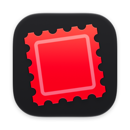
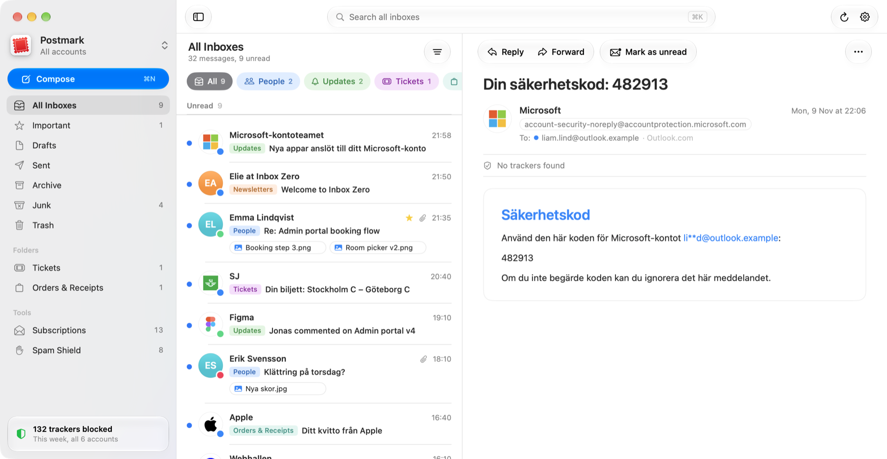

  

<h1 align="center">Postmark</h1>

  All your mail in one private inbox. 
  A native Mac mail app for Outlook, Microsoft 365, Gmail and iCloud.

  <a href="https://github.com/liammelkersson/postmark-releases/releases/latest"><b>Download for Mac</b></a>
  &nbsp;·&nbsp; macOS 26 or later &nbsp;·&nbsp; updates itself

  

## What it does

- **One inbox for every account.** Outlook.com, Microsoft 365, Gmail and iCloud side by side, one color dot per account.
- **Quick to scan.** Unread mail on top, and category pills such as People, Updates and Newsletters.
- **Private by default.** Tracking pixels are removed, images load only when you click Load images, and then through
  DuckDuckGo's proxy so senders never see your IP address.
- **Spam Shield.** Catches phishing that fakes a known brand and cold outreach that keeps following up.
- **Subscriptions.** Every newsletter in one list, with one-click unsubscribe.
- **Yours to style.** Eight window styles, your own color, and a drawer of app icons.

  

## Install

1. [Download the latest version](https://github.com/liammelkersson/postmark-releases/releases/latest) and open the DMG.
2. Drag Postmark to Applications and open it.
3. The first time, macOS says it cannot verify Postmark, because the app is not yet registered with Apple.
   Open System Settings, Privacy & Security, scroll down and click Open Anyway. This is needed once.
4. Add your accounts:
   - **Microsoft** (Outlook.com, Hotmail, Live, Microsoft 365): click Sign in with Microsoft.
   - **Gmail:** turn on 2-Step Verification, then create an app password at https://myaccount.google.com/apppasswords.
   - **iCloud:** go to https://account.apple.com, Sign-In and Security, App-Specific Passwords.

Postmark checks for new versions on its own and installs them when you say yes.

Some companies only allow approved apps to read work mail. If Microsoft says "Need admin approval", your IT admin
has to allow Postmark first.

## Privacy

- Postmark talks straight to Microsoft, Google and Apple. There is no Postmark server, no account and no analytics.
- Sign-in tokens and app passwords live only in your Mac's keychain.
- Postmark runs in the macOS App Sandbox: it can reach the network, files you pick and your Downloads folder,
  and nothing else on your Mac.
- Emails load nothing from the internet until you click Load images. Scripts in emails never run.
- Only headers and previews are kept on disk, never full emails.
- Sender logos come from files in the app, svgl.app and DuckDuckGo. No lookup tells anyone who emails you.
- The only other connection is the update check, to GitHub.

## Feedback

Found a bug or miss something? Email Liam at [liammelkersson@live.se](mailto:liammelkersson@live.se).

## About this page

This repository holds the downloads and the update feed for Postmark. The app is a personal project made for
Liam and a few friends.
